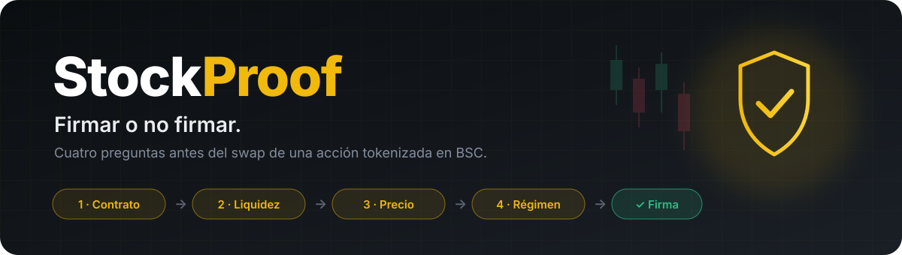
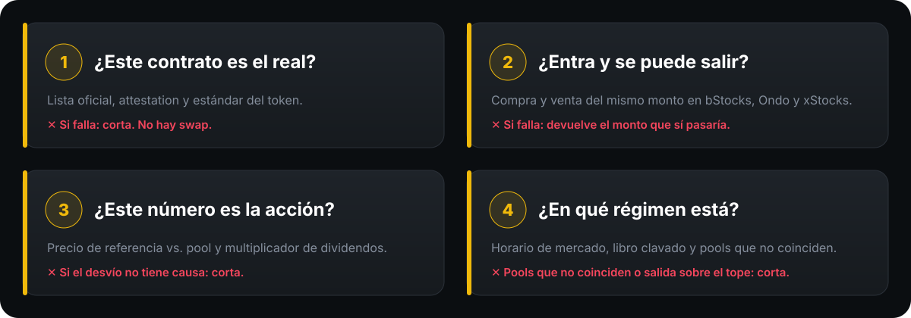
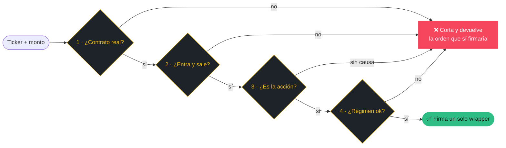
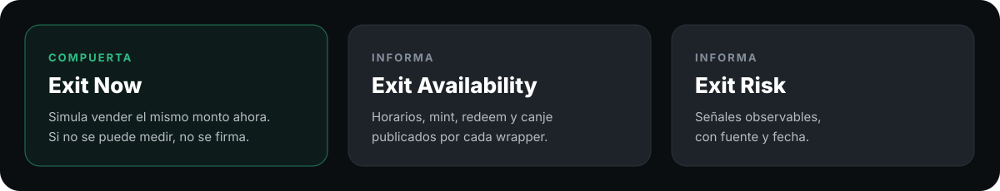

  

  
  
  
  

  Dado un <b>ticker</b> y un <b>monto en dólares</b>, StockProof dice si conviene firmar 
  el swap de esa acción tokenizada en BSC. <b>Si una pregunta falla, no hay transacción.</b>

---

## 🎯 El problema

Las acciones tokenizadas se operan las 24 horas, pero los riesgos no aparecen en la pantalla del swap:

| | Riesgo | Qué pasa |
|:-:|---|---|
| 🎭 | **Impostores** | Hay contratos que se llaman igual que el token pero no son el oficial. |
| 🌊 | **Liquidez** | Una orden grande rompe el pool, y a veces se entra pero no se puede salir. |
| 🧮 | **Precio engañoso** | Con dividendos o tokens de retorno total, el precio de la wallet no es el de la acción. |
| 🌙 | **Fuera de horario** | El sábado casi no afecta a un nombre líquido, pero en un nombre fino puede salir caro. |

## 🛡️ Las cuatro preguntas

  

## 🚪 La salida se mide antes de entrar

  

StockProof no predice el precio ni la liquidez futura. Mide lo que cuesta salir **ahora** y muestra lo que está publicado.

## ✨ Lo que lo hace distinto

> [!IMPORTANT]
> **Su trabajo visible es negarse.** Toda negativa devuelve la orden que sí firmaría: el mismo ticker y el mismo wrapper, con un monto más chico.

- 🔍 **No cambia de wrapper en silencio.** Muestra las tres cotizaciones y nombra el wrapper elegido y los que quedaron afuera.
- ⚖️ **Elige con reglas claras.** Firma el wrapper con compra y venta bajo el tope; si hay más de uno, el de menor impacto.
- 💬 **Entiende frases en castellano**, como *«comprame $200 de NVIDIA si el costo es menor al 1%»*. La frase suma condiciones, pero nunca apaga las cuatro preguntas.

## 🧰 Construido con

  
  
  
  
  
  
  

APIs de Binance que usa: **RWA Data**, **Market**, **Trading**, **Transaction** y **Wallet**.

## 📦 Repositorios

| Repo | Qué tiene |
|---|---|
| [**stock-proof**](https://github.com/StkProof/stock-proof) | La app y la lógica de decisión de las cuatro preguntas |
| [**vault-stockproof**](https://github.com/StkProof/vault-stockproof) | El contexto de producto: idea, MVP, brief y fuentes de cada número |

---

  Construido para <a href="https://www.bnbchain.org/en/hackathons/tokenized-stocks">BNB Hack: Tokenized Stocks Edition</a> · 2026 · Solo spot · Solo BSC mainnet

